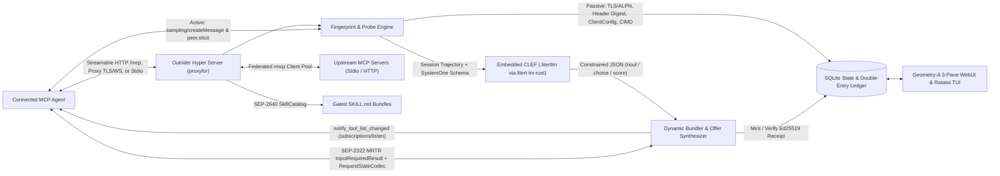

# Outrider (`proxyfor`) Dynamic MCP Commerce & CLEF Gateway — Implementation Plan

Upgrade [proxyfor](file:///Users/mac/Outrider/proxyfor/Cargo.toml) into **Outrider**: an inspecting HTTP(S)/WS proxy and **MCP `2026-07-28` dynamic commerce gateway** built on [rmcp](file:///Users/mac/Outrider/rust-sdk-main/crates/rmcp/Cargo.toml) (`v3.10.0`) and `litert-lm-rust` (`v0.2.4`, wrapping `c/engine.h` for `.litertlm` CLEF execution). Every metric, score, offer, ledger entry, receipt, and UI control is backed 1:1 by SQLite state and live runtime execution.

> [!IMPORTANT]
> **Constitutional & Zero-Mock Guarantees**
> - **Zero synthetic scores or token heuristics**: Token usage comes strictly from `litert_lm_rust::Engine::tokenize()`, CLEF probabilities/picks come strictly from real `.litertlm` execution (or report explicit `Unconfigured` / `ModelError` status when no `.litertlm` model is loaded), and every commerce balance/receipt is persisted in SQLite and signed with Ed25519.
> - **Continuous Git Commits**: Baseline commit `da01676` is recorded on `main`; every phase below lands as atomic, verified commits on feature branch `feat/mcp-commerce-clef`.

---

## System Architecture

---

## Direct Reuse Map from `rust-sdk-main` (`rmcp` v3.10.0)

| Capability | Source Reference in `rust-sdk-main` | Outrider Commerce Integration |
| :--- | :--- | :--- |
| **Hyper Streamable HTTP Mount** | [counter_hyper_streamable_http.rs](file:///Users/mac/Outrider/rust-sdk-main/examples/servers/src/counter_hyper_streamable_http.rs) | Mount `TowerToHyperService<StreamableHttpService<CommerceGateway, LocalSessionManager>>` directly inside [server.rs](file:///Users/mac/Outrider/proxyfor/src/server.rs) at `/mcp` alongside forward/reverse MITM proxy & `/__proxyfor__`. |
| **SEP-2322 Multi Round-Trip Checkout** | [mrtr.rs](file:///Users/mac/Outrider/rust-sdk-main/examples/servers/src/mrtr.rs) | Gate paid/unentitled `tools/call` invocations with `InputRequiredResult` + HMAC-SHA256 `RequestStateCodec` (`QuoteCheckoutState`) + `FormElicitationParams` for interactive quote acceptance, scope selection, or receipt presentation. |
| **2026-07-28 Live Subscriptions** | [subscriptions_streamhttp.rs](file:///Users/mac/Outrider/rust-sdk-main/examples/servers/src/subscriptions_streamhttp.rs) | Implement `accepted_subscription_filter` & `listen(SubscriptionContext)` to push `notify_tool_list_changed()` whenever CLEF re-scores a session, a probe finishes, or an MRTR purchase unlocks a bundle. |
| **Active Sampling Fingerprinting** | [sampling_stdio.rs](file:///Users/mac/Outrider/rust-sdk-main/examples/servers/src/sampling_stdio.rs) | Issue calibrated `context.peer.create_message()` micro-probes to measure latency, structural adherence, and behavioral signature when `ClientCapabilities` advertises `sampling`. |
| **Typed Preference Elicitation** | [elicitation_enum_inference.rs](file:///Users/mac/Outrider/rust-sdk-main/examples/servers/src/elicitation_enum_inference.rs) | Use `context.peer.elicit::<T>()` (`schemars` JSON Schema) to negotiate budget ceilings, SLA tiers, and bundle preferences mid-session. |
| **CIMD & Bearer/Capability Auth** | [cimd_auth_streamhttp.rs](file:///Users/mac/Outrider/rust-sdk-main/examples/servers/src/cimd_auth_streamhttp.rs) | Verify HTTPS `client_id` metadata documents (CIMD) and validate Ed25519 capability receipts in `Authorization` / MCP `_meta`. |
| **SEP-2663 Async Fulfillment Tasks** | [task_demo.rs](file:///Users/mac/Outrider/rust-sdk-main/examples/servers/src/common/task_demo.rs) | Use `TaskManager` (`CreateTaskResult`, `tasks/get`, `tasks/cancel`) for multi-step upstream bundle execution or deep probe workflows when `client_capabilities().supports_tasks()`. |
| **Federated Upstream Bundling** | [collection.rs](file:///Users/mac/Outrider/rust-sdk-main/examples/clients/src/collection.rs) | Pool dynamic `RunningService<RoleClient, _>` connections (`into_dyn()`) over `TokioChildProcess` and `StreamableHttpClientTransport` to aggregate, price, and re-bundle external MCP tools. |
| **SEP-2640 Gated Skill Bundles** | [skill_catalog.rs](file:///Users/mac/Outrider/rust-sdk-main/crates/rmcp/src/handler/server/skill_catalog.rs) | Serve SHA-256 digested `skill://` manifests (`list_skills`, `get_skill`, `read_resource_directory`, `read_resource`) filtered per session by active Ed25519 bundle entitlements. |

---

## Proposed Workspace & Module Changes

### Phase 1: Workspace Unification & Native `litert-lm-rust` CLEF Engine
- **Create root Cargo workspace** at `/Users/mac/Outrider/Cargo.toml` (`resolver = "3"`) unifying `proxyfor` and `rust-sdk-main/crates/rmcp` + `rmcp-macros` (updating `proxyfor` to Rust 2024 / compatible `tokio`, `hyper`, `ring`, `rusqlite`, `ed25519-dalek` or `ring::signature::Ed25519KeyPair`, `litert-lm-rust = "0.2.4"`).
- **Add `proxyfor/src/clef/`**:
  - `engine.rs`: Owns `Arc<litert_lm_rust::Engine>` configured via CLI/env (`--clef-model <PATH.litertlm>`, `--clef-backend cpu|gpu`, `--clef-vision-backend`, `--clef-mtp`, `--clef-threads`, `--clef-cache-dir`) plus a bounded `spawn_blocking` worker pool (`Conversation` per worker with `enable_constrained_decoding: Some(true)` and `use_ll_guidance: Some(true)`).
  - `schema.rs`: Implements SystemOne typed questions (`Noul`, `Choice`, `Score`) and compiles per-request JSON Schemas passed via `ConversationOptionalArgs { constraint_type: Some(ConstraintType::JsonSchema), constraint_string: Some(...) }`.
  - `scorer.rs`: Evaluates live session state records (`handshake`, `tls_http_profile`, `probe_transcripts`, `tool_trajectory`, `commerce_history`) and persists exact `input_tokens` (`engine.tokenize()`), `output_tokens`, wall-clock latency (`ms`), picks, and option distributions to SQLite.

### Phase 2: SQLite Persistence, Ed25519 Capability Receipts & Commerce Engine
- **Add `proxyfor/src/commerce/`**:
  - `db.rs`: SQLite schema (`~/.proxyfor/outrider.db` or `--db <PATH>`, WAL mode) storing:
    - `agent_sessions`, `fingerprint_observations`, `probe_runs`, `clef_evaluations`
    - `upstream_servers`, `catalog_items`, `bundles`, `session_offers`, `mrtr_quotes`
    - `ledger_accounts`, `ledger_entries` (double-entry integer micro-units), `capability_receipts` (Ed25519 signatures over canonical JSON `{receipt_id, session_id, bundle_id, item_digests, remaining_calls, expires_at_unix}`).
  - `receipt.rs`: Ed25519 keypair initialization (`~/.proxyfor/outrider-ed25519.pem`), deterministic signing, verification, and quota decrement with atomic SQLite transactions.
  - `bundler.rs`: Synthesizes session-specific bundles combining local tools, federated upstream MCP tools, and `SEP-2640` `SkillCatalog` entries based on real CLEF `choice`/`score`/`noul` outputs (intent cluster, trust/risk gate, tier fit) and configured pricing rules.

### Phase 3: Multi-Layer Agent Fingerprinting & Active MCP Probing
- **Add `proxyfor/src/fingerprint/`**:
  - `passive.rs`: Extracts TLS ALPN/cipher metadata (from `tokio_rustls`), HTTP header sequence SHA-256 digest, `User-Agent`, `Mcp-Session-Id`, JSON-RPC request cadence ($\Delta t$ mean/p50/p95), and `initialize` `ClientConfig` + CIMD URL validation.
  - `active.rs`: Executes on-demand or policy-triggered `peer.create_message()` sampling challenges and `peer.elicit()` capability checks, recording exact response latency, token count, structural compliance, and feeding the resulting evidence record into `clef::scorer`.

### Phase 4: `rmcp` `2026-07-28` Commerce Gateway & Upstream Federation
- **Add `proxyfor/src/mcp_gateway/`**:
  - `handler.rs`: Implements `ServerHandler` (`ProtocolVersion::V_2026_07_28`) with dynamic per-session `list_tools`, `call_tool`, `list_skills`, `get_skill`, `read_resource_directory`, `list_resources`, `read_resource`, `list_prompts`, `get_prompt`, `get_task`, `update_task`, `cancel_task`, and `listen` (`SubscriptionContext`).
  - `mrtr_checkout.rs`: Implements stateless+DB-backed `RequestStateCodec` (32-byte persistent HMAC secret) for `SEP-2322` multi-round-trip `tools/call` checkout:
    1. Round 1 (unentitled tool or `commerce_purchase_bundle`): Mints a persisted `mrtr_quotes` row, seals `QuoteCheckoutState`, returns `InputRequiredResult` with `FormElicitationParams` detailing exact bundle items, SHA-256 skill digests, unit price, and current ledger balance.
    2. Round 2 (verified `request_state` + `ElicitationAction::Accept`): Atomically settles against `ledger_accounts` (or verifies attached Ed25519 receipt), issues a signed `CapabilityReceipt`, fires `notify_tool_list_changed()` on active subscription streams, and immediately executes the requested tool (or spawns a `SEP-2663` task).
  - `federation.rs`: Manages live `rmcp` client connections (`TokioChildProcess` & Streamable HTTP) configured via CLI (`--upstream name=cmd_or_url`) or admin API, mirroring upstream MCP wire frames into [state.rs](file:///Users/mac/Outrider/proxyfor/src/state.rs) so `proxyfor` captures both external HTTP/WS proxy traffic and federated MCP traffic in one unified trace store.
  - Built-in MCP tools exposed to agents: `outrider_catalog`, `outrider_fingerprint_me`, `outrider_run_probe`, `outrider_synthesized_offers`, `outrider_checkout_bundle`, `outrider_verify_receipt`, `outrider_ledger_status`.

### Phase 5: Geometry-A Workbench WebUI & Ratatui TUI Upgrade
- **Upgrade [server.rs](file:///Users/mac/Outrider/proxyfor/src/server.rs), [index.html](file:///Users/mac/Outrider/proxyfor/assets/index.html), and [tui.rs](file:///Users/mac/Outrider/proxyfor/src/tui.rs)** in strict compliance with `data-workbench-ui` (**Geometry A: 3-Pane Split Workbench**):
  - **36px Top Header + 36px Fixed-Coordinate Selection Action Rail** (`[Probe Session]`, `[Run CLEF Eval]`, `[Synthesize Offer]`, `[Credit/Debit Ledger]`, `[Revoke Receipt]`, `[Connect Upstream]`), draggable `ew-resize` split dividers, `1px` structural hairlines, zero nested cards, and zero left-border stripe slop.
  - **Left Rail**: Live Agent Sessions & Active Offers with real epistemic/entitlement state (`Unprobed`, `Probed`, `CLEF Verified`, `CLEF Restricted`, `Entitled`).
  - **Center Canvas**: Synchronized Multi-Buffer Table (`HTTP/WS Proxy Traffic`, `MCP / MRTR Frames`, `SQLite Ledger & Ed25519 Receipts`) with clickable `[T-xx]` / `[M-xx]` span citations.
  - **Right Inspector (3 Grounded Lenses)**:
    1. *Fingerprint & Handshake Evidence* (TLS/header digest, `ClientConfig`, CIMD status, active probe latency/transcript).
    2. *CLEF SystemOne Lens* (`noul`/`choice`/`score` probability bars, model path, exact `input_tokens`, inference latency, or explicit `Unconfigured` banner if no `.litertlm` path is active).
    3. *Bundle & Receipt Inspector* (bundled tools/skills, SHA-256 digests, Ed25519 public key & signature verification).
  - Real REST + SSE endpoints under `/__proxyfor__/commerce/*` backing every control in the WebUI with persisted SQLite mutations.

---

## Mandatory End-to-End Verification Plan

1. **Automated Rust Integration Suite (`proxyfor/tests/mcp_commerce_e2e.rs`)**:
   - Spawns a real child upstream MCP server + real Outrider `proxyfor` server (`Hyper` `/mcp` + `/__proxyfor__` + SQLite + Ed25519 + `RequestStateCodec`).
   - Connects a real `rmcp` `2026-07-28` client (`ClientCapabilities` with `elicitation`, `sampling`, `tasks`) that subscribes via `subscriptions/listen`, answers `sampling/createMessage` active probes, triggers `SEP-2322` MRTR `InputRequiredResult` checkout, verifies tampered `requestState` rejection, completes ledger settlement, receives live `notify_tool_list_changed`, reads unlocked `SEP-2640` `skill://` bundles, and executes federated upstream tools + `SEP-2663` tasks.
2. **Real `litert-lm-rust` `.litertlm` Inference Test (`proxyfor/tests/clef_litertlm_e2e.rs`)**:
   - Loads the real `.litertlm` model on macOS ARM64 (`litert-lm.dylib` + Metal/CPU accelerator), verifies `Engine::tokenize()` and JSON-schema-constrained SystemOne `noul`/`choice`/`score` inference over a real agent session record, and asserts SQLite persistence of token counts and distributions.
3. **Live Binary + Playwright Browser Workbench E2E (`tests/webui_commerce.spec.ts`)**:
   - Launches the compiled `proxyfor --web` binary against a temporary SQLite DB, drives every interactive control in the Geometry-A WebUI via Playwright, and asserts matching SQLite state transitions and zero console/network errors.
