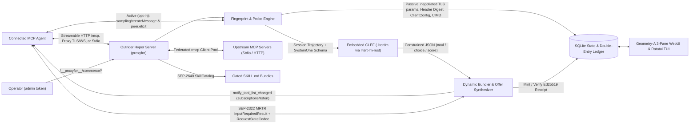

# Outrider (`proxyfor`) Dynamic MCP Commerce & CLEF Gateway — Implementation Plan (Revision 2)

Upgrade [proxyfor](file:///Users/mac/Outrider/proxyfor/Cargo.toml) into **Outrider**: an inspecting HTTP(S)/WS proxy and **MCP `2026-07-28` dynamic commerce gateway** built on [rmcp](file:///Users/mac/Outrider/rust-sdk-main/crates/rmcp/Cargo.toml) (`v3.10.0`) and `litert-lm-rust` (`v0.2.4`) for `.litertlm` CLEF execution. Every metric, score, offer, ledger entry, receipt, and UI control is backed 1:1 by SQLite state and live runtime execution.

> [!IMPORTANT]
> **Constitutional & Zero-Mock Guarantees**
> - **Zero synthetic scores or token heuristics**: token counts come only from `litert_lm_rust::Engine::tokenize()`; CLEF picks come only from real `.litertlm` execution; with no model loaded the status is an explicit `Unconfigured` / `ModelError`. Every balance and receipt is persisted in SQLite and signed with Ed25519.
> - **No distribution without a measured source**: a probability or option distribution is stored and rendered only when the runtime returned real scores for that evaluation (see Phase 0 and Phase 1). Otherwise the field is `NULL` and the UI omits the bars. It is never derived, normalised from text, or defaulted.
> - **Continuous Git commits**: baseline `da01676` is on `main`; every phase lands as atomic, verified commits on `feat/mcp-commerce-clef`, and each phase's exit gate must pass before the next phase starts.

## What changed from Revision 1

| # | Gap in Revision 1 | Resolution |
| :--- | :--- | :--- |
| 1 | "Probability bars" had no data source: the constrained `Conversation` API returns text only. | New Phase 0 spike measures what `Session` `Responses::score_at` / `token_scores_at` actually return for the chosen model; distributions are conditional on that result. |
| 2 | A root workspace cannot adopt `rmcp` as a member: `rust-sdk-main` is already a workspace root and `rmcp` inherits `version`/`edition` from it. | Root workspace has `members = ["proxyfor"]`, `exclude = ["rust-sdk-main"]`; `rmcp` and `rmcp-macros` are path dependencies. |
| 3 | No auth on mutating admin endpoints, while `proxyfor` binds `0.0.0.0:8080` by default and `/__proxyfor__` is unauthenticated today. | Admin token + loopback default for all `/__proxyfor__/commerce/*` mutations (Phase 2). |
| 4 | Ledger had no stated source of funds. | Stated explicitly: operator-issued credits only, no payment rail (Open Decision A). |
| 5 | Active sampling probes spend the agent's tokens without consent. | Probes are off by default and gated on policy + disclosure (Phase 3, Open Decision B). |
| 6 | TLS fingerprint overstated: `tokio_rustls` exposes only negotiated ALPN/cipher/version. | Passive evidence is renamed and scoped to what is observable; ClientHello capture is an explicit optional item. |
| 7 | No TUI test, no model path for the CLEF test, tests only at the end, build-time binary download. | Per-phase exit gates, a TUI test, a named model path, and a pinned native-library policy. |

---

## System Architecture

---

## Direct Reuse Map from `rust-sdk-main` (`rmcp` v3.10.0)

All nine source files and the symbols named below were confirmed present in the repo at `da01676`.

| Capability | Source Reference in `rust-sdk-main` | Outrider Commerce Integration |
| :--- | :--- | :--- |
| **Hyper Streamable HTTP Mount** | [counter_hyper_streamable_http.rs](file:///Users/mac/Outrider/rust-sdk-main/examples/servers/src/counter_hyper_streamable_http.rs) | Mount `TowerToHyperService<StreamableHttpService<CommerceGateway, LocalSessionManager>>` inside [server.rs](file:///Users/mac/Outrider/proxyfor/src/server.rs) at `/mcp` alongside the forward/reverse MITM proxy and `/__proxyfor__`. |
| **SEP-2322 Multi Round-Trip Checkout** | [mrtr.rs](file:///Users/mac/Outrider/rust-sdk-main/examples/servers/src/mrtr.rs) | Gate paid/unentitled `tools/call` with `InputRequiredResult` + HMAC-SHA256 `RequestStateCodec` (`QuoteCheckoutState`) + `FormElicitationParams`. |
| **2026-07-28 Live Subscriptions** | [subscriptions_streamhttp.rs](file:///Users/mac/Outrider/rust-sdk-main/examples/servers/src/subscriptions_streamhttp.rs) | Implement `accepted_subscription_filter` and `listen(SubscriptionContext)` to push `notify_tool_list_changed()` when CLEF re-scores a session, a probe finishes, or a purchase unlocks a bundle. |
| **Active Sampling Fingerprinting** | [sampling_stdio.rs](file:///Users/mac/Outrider/rust-sdk-main/examples/servers/src/sampling_stdio.rs) | Opt-in `context.peer.create_message()` micro-probes when `ClientCapabilities` advertises `sampling` and probe policy allows it. |
| **Typed Preference Elicitation** | [elicitation_enum_inference.rs](file:///Users/mac/Outrider/rust-sdk-main/examples/servers/src/elicitation_enum_inference.rs) | `context.peer.elicit::<T>()` to negotiate budget ceilings, SLA tiers, and bundle preferences. |
| **CIMD & Bearer/Capability Auth** | [cimd_auth_streamhttp.rs](file:///Users/mac/Outrider/rust-sdk-main/examples/servers/src/cimd_auth_streamhttp.rs) | Verify HTTPS `client_id` metadata documents and validate Ed25519 capability receipts in `Authorization` / MCP `_meta`. |
| **SEP-2663 Async Fulfillment Tasks** | [task_demo.rs](file:///Users/mac/Outrider/rust-sdk-main/examples/servers/src/common/task_demo.rs) | `TaskManager` for multi-step upstream bundle execution when `client_capabilities().supports_tasks()`. |
| **Federated Upstream Bundling** | [collection.rs](file:///Users/mac/Outrider/rust-sdk-main/examples/clients/src/collection.rs) | Pool `RunningService<RoleClient, _>` connections over `TokioChildProcess` and `StreamableHttpClientTransport`. |
| **SEP-2640 Gated Skill Bundles** | [skill_catalog.rs](file:///Users/mac/Outrider/rust-sdk-main/crates/rmcp/src/handler/server/skill_catalog.rs) | Serve SHA-256 digested `skill://` manifests filtered per session by active bundle entitlements. |

---

## Open Decisions (need Ryan's answer; defaults below apply until then)

- **A. Ledger funding.** There is no payment rail in this plan. Default: balances are operator-issued credits created only through the authenticated admin API, stored as integer micro-units, and labelled "operator credit" everywhere they appear. They are never described as money or as a settled payment.
- **B. Active probe consent.** `sampling/createMessage` makes the agent's host spend its own model tokens. Default: probes are disabled unless `--probe-policy on-request|auto` is set; every probe request carries a plain statement of purpose in the message, and `outrider_run_probe` (agent-initiated) is always allowed.
- **C. ClientHello capture.** Default: not built. JA3/JA4-style fingerprints need the raw ClientHello, which means reading it before the `tokio_rustls` acceptor. Build only if Ryan wants it.

---

## Phases

Each phase ends with an **exit gate**: tests that must pass, committed, before the next phase begins.

### Phase 0: Feasibility Spikes (throwaway binaries under `proxyfor/examples/`, results committed as test fixtures)
- **Workspace + build spike**: root `Cargo.toml` with `[workspace] members = ["proxyfor"]`, `exclude = ["rust-sdk-main"]`, `resolver = "3"`; `proxyfor` moves to edition 2024 / `rust-version = "1.88"` and takes `rmcp = { path = "../rust-sdk-main/crates/rmcp", features = [...] }`. Confirm one resolved `hyper`/`tokio`/`rustls` set with `ring` as the only crypto provider (`rmcp`'s `reqwest` must use `reqwest-tls-no-provider` or match `ring`).
- **Native library policy**: `litert-lm-rust`'s default `download-native` feature fetches prebuilt libraries into `~/.noema/prebuilt` at build time. Disable default features, vendor or pin the library by SHA-256, and record the version in the repo.
- **CLEF scoring spike** against `~/.avery/redteam-models/gemma-4-e2b-it.litertlm` (or the path Ryan names):
  1. Constrained `Conversation` with `ConstraintType::JsonSchema` returns schema-valid JSON for `noul`, `choice`, and `score`.
  2. `Session::generate_content_responses` → record whether `Responses::score_at` and `token_scores_at` return `Some`, and what the values are (log-likelihoods or otherwise), for this model and backend.
- **Exit gate**: a committed written result stating which of {pick only, pick + per-option scores} the runtime really provides. Phase 1's schema follows that result. If scores are unavailable, distributions are dropped from the plan, not approximated.

### Phase 1: Native `litert-lm-rust` CLEF Engine
- **Add `proxyfor/src/clef/`**:
  - `engine.rs`: owns `Arc<litert_lm_rust::Engine>` configured via CLI/env (`--clef-model <PATH.litertlm>`, `--clef-backend cpu|gpu`, `--clef-threads`, `--clef-cache-dir`) plus a bounded `spawn_blocking` worker pool.
  - `schema.rs`: SystemOne typed questions (`Noul`, `Choice`, `Score`) compiled to per-request JSON Schemas passed through `ConversationOptionalArgs { constraint_type, constraint_string }`.
  - `scorer.rs`: evaluates live session records and persists exact `input_tokens` (`engine.tokenize()`), `output_tokens`, wall-clock latency, the pick, and `option_scores` **only if Phase 0 proved a real source** (nullable column; `NULL` when the runtime returned none).
- **Exit gate**: `proxyfor/tests/clef_litertlm_e2e.rs` loads the real model, runs all three question types over a real recorded session, and asserts the SQLite rows. The test is skipped with a printed reason, not passed, when `OUTRIDER_CLEF_MODEL` is unset.

### Phase 2: SQLite Persistence, Receipts, Ledger & Admin Auth
- **Add `proxyfor/src/commerce/`**:
  - `db.rs`: SQLite (`~/.proxyfor/outrider.db` or `--db <PATH>`, WAL) with `agent_sessions`, `fingerprint_observations`, `probe_runs`, `clef_evaluations`, `upstream_servers`, `catalog_items`, `bundles`, `session_offers`, `mrtr_quotes`, `ledger_accounts`, `ledger_entries` (double-entry, integer micro-units, sum-to-zero check per transaction), `capability_receipts`, `admin_audit_log`.
  - `receipt.rs`: Ed25519 keypair at `~/.proxyfor/outrider-ed25519.pem` created with mode `0600`; signing over canonical JSON `{receipt_id, session_id, bundle_id, item_digests, remaining_calls, expires_at_unix}`; verification; quota decrement and revocation in atomic transactions.
  - `bundler.rs`: synthesizes session-specific bundles from local tools, federated upstream tools, and `SkillCatalog` entries using real CLEF outputs and configured pricing rules. With CLEF `Unconfigured`, it offers only the static configured catalog and says so.
  - `admin_auth.rs`: every mutating `/__proxyfor__/commerce/*` route requires a bearer admin token (generated on first run, stored `0600`, printed once) and is refused from non-loopback peers unless `--admin-allow-remote` is set. The HMAC `RequestStateCodec` secret is stored the same way. Every admin mutation writes `admin_audit_log`.
- **Exit gate**: integration tests for ledger invariants (no negative balance, entries sum to zero, concurrent settlement), receipt tamper/expiry/revocation rejection, and `401`/`403` on unauthenticated or remote admin calls.

### Phase 3: Agent Fingerprinting & Opt-In Probing
- **Add `proxyfor/src/fingerprint/`**:
  - `passive.rs`: negotiated TLS version, ALPN, and cipher suite (what `tokio_rustls` exposes after the handshake); HTTP header-order SHA-256 digest; `User-Agent`; `Mcp-Session-Id`; JSON-RPC request cadence (mean/p50/p95); `initialize` `ClientConfig`; CIMD URL validation. Stored and labelled as "negotiated TLS parameters", not as a TLS fingerprint.
  - `active.rs`: `peer.create_message()` challenges and `peer.elicit()` checks, run only under the probe policy in Open Decision B, recording exact latency, token count, and structural compliance, then feeding `clef::scorer`. A declined or failed probe is stored as declined/failed.
- **Exit gate**: integration test with a real `rmcp` client covering probe-off (no `sampling/createMessage` sent), probe-on, and client-declined paths, asserting the stored rows.

### Phase 4: `rmcp` `2026-07-28` Commerce Gateway & Upstream Federation
- **Add `proxyfor/src/mcp_gateway/`**:
  - `handler.rs`: `ServerHandler` (`ProtocolVersion::V_2026_07_28`) with per-session `list_tools`, `call_tool`, `list_skills`, `get_skill`, `read_resource_directory`, `list_resources`, `read_resource`, `list_prompts`, `get_prompt`, `get_task`, `update_task`, `cancel_task`, and `listen`.
  - `mrtr_checkout.rs`: `SEP-2322` checkout.
    1. Round 1 (unentitled tool or `outrider_checkout_bundle`): persist an `mrtr_quotes` row with an expiry, seal `QuoteCheckoutState`, return `InputRequiredResult` with `FormElicitationParams` listing exact bundle items, skill digests, unit price, and current operator-credit balance.
    2. Round 2 (verified `request_state` + `ElicitationAction::Accept`): atomically settle against `ledger_accounts` or verify an attached receipt, mark the quote consumed (single use; replays rejected), issue a signed `CapabilityReceipt`, fire `notify_tool_list_changed()`, then execute the tool or spawn a `SEP-2663` task. Insufficient balance returns an error result; nothing is granted.
  - `federation.rs`: live `rmcp` client connections configured via `--upstream name=cmd_or_url` or the admin API, mirroring upstream MCP frames into [state.rs](file:///Users/mac/Outrider/proxyfor/src/state.rs). Upstream failures surface as errors to the agent and the UI.
  - Built-in tools: `outrider_catalog`, `outrider_fingerprint_me`, `outrider_run_probe`, `outrider_synthesized_offers`, `outrider_checkout_bundle`, `outrider_verify_receipt`, `outrider_ledger_status`.
- **Exit gate**: `proxyfor/tests/mcp_commerce_e2e.rs` — real child upstream MCP server, real Outrider server, real `rmcp` client that subscribes, completes MRTR checkout, proves tampered, expired, and replayed `requestState` are rejected, proves insufficient balance grants nothing, receives `notify_tool_list_changed`, reads unlocked `skill://` bundles, and runs federated tools and tasks.

### Phase 5: Geometry-A Workbench WebUI & Ratatui TUI
- **Upgrade [server.rs](file:///Users/mac/Outrider/proxyfor/src/server.rs), [index.html](file:///Users/mac/Outrider/proxyfor/assets/index.html), and [tui.rs](file:///Users/mac/Outrider/proxyfor/src/tui.rs)** per `data-workbench-ui` (**Geometry A: 3-Pane Split Workbench**):
  - 36px top header + 36px selection action rail (`[Probe Session]`, `[Run CLEF Eval]`, `[Synthesize Offer]`, `[Credit/Debit Ledger]`, `[Revoke Receipt]`, `[Connect Upstream]`), draggable split dividers, `1px` hairlines, no nested cards. A control whose precondition is unmet (no model, probes disabled, no admin token) is disabled with the reason shown; it never reports success without the backend mutation.
  - **Left rail**: live agent sessions and offers with state read from SQLite (`Unprobed`, `Probed`, `CLEF Verified`, `CLEF Restricted`, `Entitled`).
  - **Center canvas**: `HTTP/WS Proxy Traffic`, `MCP / MRTR Frames`, `SQLite Ledger & Ed25519 Receipts` with clickable `[T-xx]` / `[M-xx]` citations.
  - **Right inspector**: (1) fingerprint and handshake evidence; (2) CLEF lens showing pick, model path, exact `input_tokens`, latency, and score bars only when `option_scores` is non-`NULL`, or an `Unconfigured` banner; (3) bundle and receipt inspector with digests and signature verification.
  - REST + SSE endpoints under `/__proxyfor__/commerce/*`; mutations go through `admin_auth`. HTTP errors are shown as errors.
- **Exit gate**:
  - `tests/webui_commerce.spec.ts` (Playwright) launches the compiled `proxyfor --web` binary against a temporary SQLite DB, drives every control, and asserts the matching SQLite transitions, the unauthenticated-admin failure path, the `Unconfigured` state, and zero console/network errors.
  - `proxyfor/tests/tui_commerce.rs` renders the new TUI views with `ratatui::backend::TestBackend` from a real seeded DB and drives each key binding, asserting the same state transitions.
  - Manual launch of the real binary with a real model and a real MCP client before the work is reported complete.
